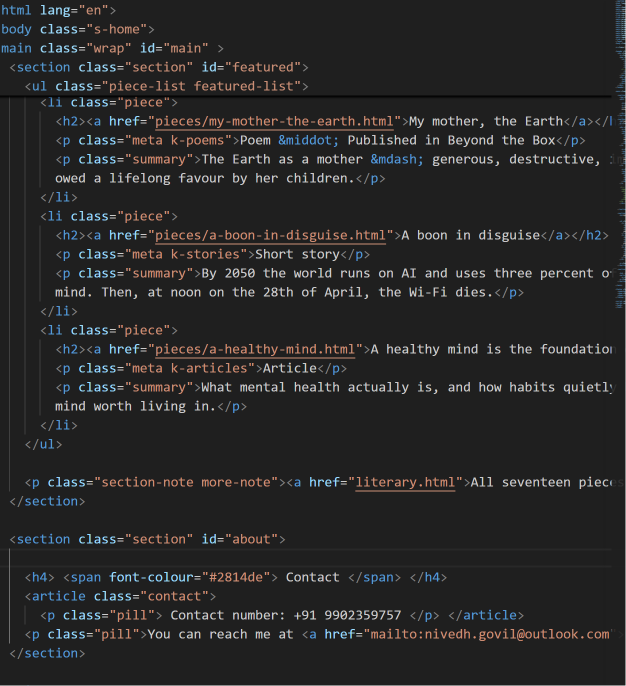
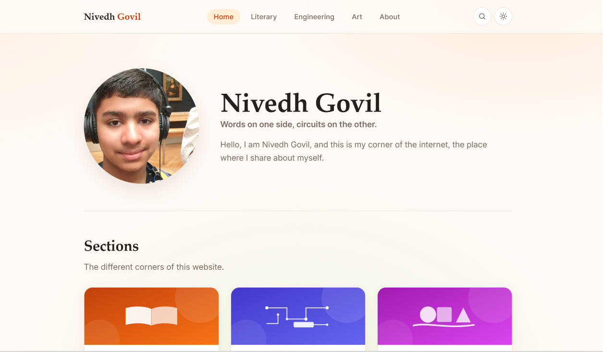
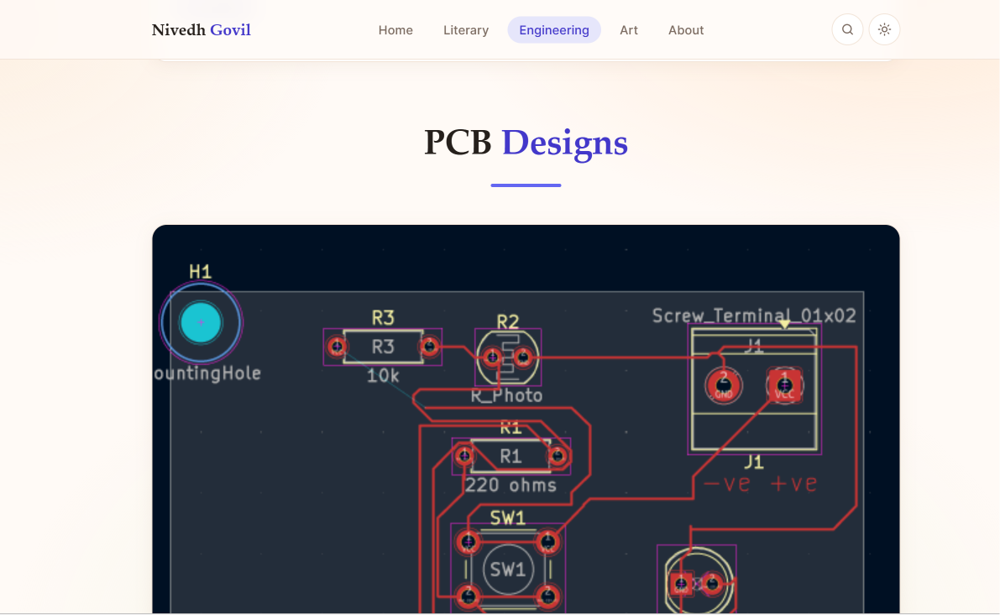

# My own website.

I am Nivedh and this is the README for my own **personal website**, a project I've been longing for a very long time. This website has some of the skills which I have, for example, engineering, writing, and art.

On opening my website the first page is the home page, which has a brief description of the entire website, some more things, and a way to contact me. The other pages, for example, the Literary page, have links to my work, for example, the articles, essays, and poems I have written.

I've used **HTML**, **CSS**, and a little bit of **JavaScript**. There is no framework and no build step — every page is a plain HTML file you can open straight from disk.

## Use of AI

I wrote the words on this site. AI helped me with the CSS and the JavaScript, and later with the layout, the accessibility and the interactive parts listed below.

## Pages

| File | Description |
| --- | --- |
| `index.html` | Home page |
| `literary.html` | My write-ups |
| `articles.html` | Articles I have written |
| `essays.html` | Essays I have written |
| `research.html` | Research papers |
| `poems.html` | Poems I have written |
| `short-stories.html` | Short stories I have written |
| `books.html` | Books I recommend |
| `engineering.html` | Arduino builds, with a video of each |
| `designs.html` | CAD models |
| `electrical.html` | Schematics and PCB layouts |
| `software.html` | Software projects, with code and demos |
| `art.html` | My drawings |
| `music.html` | Music (not filled in yet, so it is hidden from the menu) |
| `about.html` | About me, and how to get in touch |
| `404.html` | Shown when a link does not exist |
| `pieces/` | The 17 pieces themselves, one file each |

## What the JavaScript does

All of it lives in `assets/site.js`. Nothing here is needed to read the site — with JavaScript off every page still works.

- **Terminal** — press `` ` `` or the `>_` button and walk the site like a filesystem: `ls`, `cd`, `cat`, `open`, `tree`.
- **Search** — press `/` or `Ctrl`+`K`. The index is built by `tools/build.py`.
- **Dark mode** — the sun/moon button, remembered between visits.
- **Lightbox** — click any artwork, CAD model, schematic or photograph to see it full size.
- **Art carousel** — arrow keys move through the gallery.
- **Reading progress** — a bar along the top of a long piece.
- **Copy** — the button beside my email address.

## Deployment

The site is live at **[nivedhgovil.vercel.app](https://nivedhgovil.vercel.app/)**, served from the root by Vercel.

## How to run it

1. Clone the repo:

```bash
git clone https://github.com/NivedhGovil/my-website.git
```
2. Open the folder:
```bash
cd my-website
```
3. Open `index.html` in a browser.

Search needs the files to be served rather than opened from disk, so for that:

```bash
python3 -m http.server
```
and go to `http://localhost:8000`.

## Tools

| File | What it does |
| --- | --- |
| `tools/build.py` | Rebuilds `assets/search-index.js` from the pages. Run it after adding a piece. |
| `tools/render_stl.py` | Renders a preview image from an STL file. |

## Images of the progress

Here are some screenshots: <br>
 <br>
 <br>

